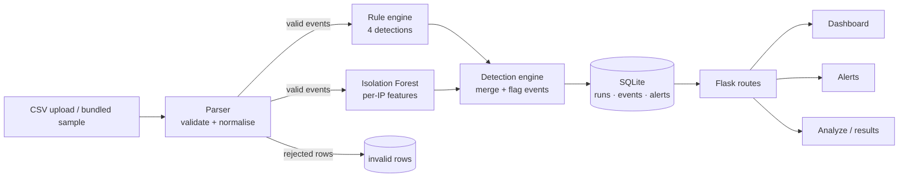

# CyberFox — AI-Assisted Security Event Detection

CyberFox is a defensive security-event detection prototype for small security teams. It
ingests a CSV of login, web and connection events, validates every row, applies four
rule-based detections and an Isolation Forest anomaly model, and presents the result in a
dark operations dashboard with alert triage and CSV analysis pages.

Alerts are generated only by the detection engine. Nothing on the dashboard or alerts page
is hardcoded, and the optional `label` column is used for evaluation only — never for
detection.

dashboard.png

## Features

- **Row-level CSV validation** — required columns, timestamps, IP addresses, ports and
  value ranges. Invalid rows are reported with their physical line number and a reason
  instead of crashing the analysis.
- **Rule-based detection** — brute force, port scan, request flood and off-hours login,
  each mapped to a MITRE ATT&CK technique.
- **Behavioural anomaly detection** — an Isolation Forest scores every source IP on five
  flow features and explains the most unusual feature in plain English.
- **Dashboard** — total records, analysed events, suspicious events and security alerts,
  normal-vs-suspicious donut, events-per-hour chart, suspicious sources, suspicious logins
  and recent security events.
- **Alert triage** — every alert with severity, timestamp, IP, user, reason, source and
  MITRE technique; search plus severity and source filters.
- **Analyze page** — drag-and-drop upload, eight-row preview, dataset statistics, rejected
  rows with line numbers, then a stored result with links to the dashboard and alerts.
- **Bundled sample dataset** — analysed automatically on first start and downloadable from
  the Analyze page.
- **SQLite persistence** — runs, events, alerts and rejected rows survive restarts.
- **Responsive dark theme** — Chakra Petch and Sora, fox-shield logo, mobile tables that
  become stacked cards, and visible keyboard focus.

## Architecture



```
cyberfox/
├─ app.py                     # Flask app factory, routes, SQLite
├─ api/index.py               # Vercel entrypoint (exposes the WSGI app)
├─ detection/
│  ├─ parser.py               # CSV validation and statistics
│  ├─ rules.py                # brute force, port scan, flood, off-hours
│  ├─ ml_model.py             # per-IP features + Isolation Forest
│  ├─ engine.py               # merges rules and ML, flags events
│  └─ evaluate.py             # precision / recall / F1 against labels
├─ data/
│  ├─ generate_dataset.py     # seeded 2,000-row synthetic dataset
│  └─ sample_logs.csv
├─ tests/                     # 46 pytest tests
├─ templates/                 # base, dashboard, alerts, analyze, error
├─ static/                    # theme, JS, favicon
├─ docs/                      # report, slides, screenshots
├─ README.md
├─ TESTING.md
├─ vercel.json                # Vercel build + catch-all route
└─ requirements.txt
```

The parser is the only module that touches untrusted input. It returns valid events, a
list of rejected rows and summary statistics. The rule engine and the ML model receive only
valid events; the engine merges their alerts, marks flagged events and produces the counts
used by every page.

## Setup and run

Requires Python 3.11 or newer.

```bash
cd cyberfox
python -m venv .venv
source .venv/bin/activate        # Windows: .venv\Scripts\activate
pip install -r requirements.txt
python data/generate_dataset.py  # optional: regenerate the sample CSV
python app.py
```

Open <http://127.0.0.1:5000>. On first start the bundled sample is analysed automatically,
so the dashboard is populated immediately. Delete `cyberfox.db` to reset the stored runs.

Run the test suite:

```bash
python -m pytest
```

Evaluate detection quality against the optional ground-truth label:

```bash
python -m detection.evaluate
```

## Deploy on Vercel (demo)

The repo includes `api/index.py`, `vercel.json` and `.vercelignore`, so Vercel can run the
Flask app as a single Python function with every route pointed at it.

1. Create a GitHub repository and upload this folder so `app.py` sits at the repository
   root. If GitHub's web upload nests everything under `cyberfox/`, set Vercel's **Root
   Directory** to `cyberfox` during import.
2. In Vercel choose **Add New → Project** and import the repository.
3. Keep **Framework Preset: Other** and leave the build command empty.
4. Optional: add an environment variable `SECRET_KEY` with a long random value.
5. Click **Deploy** and open the generated `*.vercel.app` URL. Vercel sets `VERCEL=1`
   automatically; the app then writes its SQLite database and uploads under `/tmp`.
   `vercel.json` pins Python 3.12 and allows 60 seconds per request, which covers the
   first cold request that installs and runs the model.

Serverless limitations to know before showing it:

- `/tmp` is ephemeral, so the database and uploads reset on a cold start. The bundled sample
  is analysed again automatically, so the dashboard still loads.
- Upload preview stores the file on one function instance. If the follow-up analyze request
  lands on a different instance, the page asks for the file again.
- pandas and scikit-learn are large dependencies. If Vercel rejects the function size or the
  cold start is too slow, deploy the same repo to Render/Railway with a persistent disk and
  the start command `python app.py`.

## Routes

| Route | Method | Purpose |
| --- | --- | --- |
| `/` | GET | Redirect to `/dashboard` |
| `/dashboard` | GET | Latest run: cards, donut, hourly chart, sources, logins, recent events |
| `/alerts` | GET | Alert table with `q`, `severity`, `source`, `run_id` filters |
| `/analyze` | GET | Upload form, or a stored run result with `?run_id=` |
| `/analyze/preview` | POST | Validate an upload or the sample and show the preview |
| `/analyze/run` | POST | Run the engine on a validated upload and store the result |
| `/sample.csv` | GET | Download the bundled sample dataset |

## CSV format

UTF-8 CSV with a header row. Column names are case-insensitive.

| Column | Required | Rule | Example |
| --- | --- | --- | --- |
| `timestamp` | Yes | `YYYY-MM-DD HH:MM:SS` | `2026-03-02 10:10:00` |
| `ip` | Yes | IPv4 or IPv6 | `203.0.113.45` |
| `user` | Yes | Non-empty string | `admin` |
| `event` | Yes | `login`, `web` or `conn` | `login` |
| `status` | Yes | `success`, `fail`, `ok` or `denied` | `fail` |
| `port` | Yes | Integer 1–65535 | `22` |
| `bytes` | Yes | Integer, 0 or more | `412` |
| `label` | No | `1` = attack, `0` = benign; evaluation only | `1` |

```csv
timestamp,ip,user,event,status,port,bytes,label
2026-03-02 10:10:00,203.0.113.45,admin,login,fail,22,180,1
2026-03-02 10:11:00,203.0.113.45,admin,login,fail,22,164,1
```

Rejected rows are shown in the preview and stored with the run, for example:

```
Line 8: invalid IP address 'not-an-ip'
```

## Detection methods

### Rules

| Detection | Logic | Severity | MITRE |
| --- | --- | --- | --- |
| Brute force | ≥ 5 failed logins from one IP inside a sliding 10-minute window; raised to Critical and extended if a successful login follows the burst | Critical / High | T1110 — Brute Force |
| Port scan | ≥ 15 distinct ports contacted by one IP (`conn` events) | High | T1046 — Network Service Discovery |
| Request flood | ≥ 60 events from one IP in a single clock minute | High | T1498 — Network Denial of Service |
| Off-hours login | Successful login between 23:00 and 05:00 | Medium | T1078 — Valid Accounts |

### Machine learning

| Item | Value |
| --- | --- |
| Model | `IsolationForest(n_estimators=200, contamination=0.2, random_state=42)` |
| Unit of analysis | Source IP |
| Features | total events, failed logins, distinct ports, peak requests/minute, off-hours logins |
| Score | Min–max scaled anomaly score, 0–100 relative to the batch |
| Severity | ≥ 85 Critical, ≥ 70 High, ≥ 55 Medium, otherwise Low |
| Explanation | Largest absolute z-score feature, with the population mean for comparison |

The ML path needs at least five distinct source IPs to build a comparison baseline. Reasons
name a concrete feature, for example: "Unusually high distinct ports contacted: 25 vs
median 4 across 29 IPs".

### MITRE ATT&CK coverage

| Technique | Name | Covered by |
| --- | --- | --- |
| T1110 | Brute Force | Failed-login burst rule |
| T1046 | Network Service Discovery | Distinct-port rule |
| T1498 | Network Denial of Service | Request-flood rule |
| T1078 | Valid Accounts | Off-hours successful-login rule |

ML alerts describe behavioural anomalies and do not claim a specific technique.

## Results on the bundled dataset

Generated by `python -m detection.evaluate` over 2,000 events (117 malicious, 1,883 benign):

| Approach | TP | FP | FN | Precision | Recall | F1 |
| --- | ---: | ---: | ---: | ---: | ---: | ---: |
| Rules | 117 | 0 | 0 | 1.000 | 1.000 | 1.000 |
| ML | 117 | 56 | 0 | 0.676 | 1.000 | 0.807 |
| Combined | 117 | 56 | 0 | 0.676 | 1.000 | 0.807 |

Detection totals for the sample:

| Metric | Value |
| --- | ---: |
| Total events | 2,000 |
| Analysed (valid) events | 2,000 |
| Suspicious events | 173 (8.65%) |
| Alerts | 12 (6 rule, 6 ML) |
| Severity mix | 4 Critical, 4 High, 3 Medium, 1 Low |
| Unique source IPs / users | 29 / 19 |
| Login events / failed logins | 668 / 42 (6.3% failure rate) |

The rules reach perfect scores because the synthetic attacks were generated to match the
documented thresholds. The ML false positives come from one benign internal IP
(`192.168.1.14`, 56 events) whose traffic profile is statistically unusual. Combined equals
ML because the evaluation counts any event covered by either approach, and the ML IP-level
alerts already cover all malicious rows. These numbers describe this synthetic dataset only;
they are not a claim about production accuracy.

## Security controls

- CSV extension allow-list checked after `secure_filename`; non-CSV uploads rejected.
- 10 MB request limit (`MAX_CONTENT_LENGTH`) with a 413 page.
- Uploads stored under a random UUID token; the original name is kept only for display.
- Stored tokens are validated against a strict pattern, resolved, and must stay inside the
  upload directory and end in `.csv` — traversal attempts are rejected.
- Uploaded files are deleted after analysis; only parsed records remain in SQLite.
- All output is rendered through Jinja autoescaping; no `eval` or dynamic imports.
- Every SQL statement is parameterised, including search and filters.

This is a local prototype: there is no user authentication, TLS or rate limiting, so it
should not be exposed to an untrusted network as-is.

## Limitations

- Synthetic data: attacks are injected, so rule precision is optimistic by construction.
- One dataset and one contamination setting; no cross-validation or tuning split.
- The ML model flags an entire IP's events, which inflates its false-positive count when a
  benign host looks different from the population.
- Statistical anomalies are not always attacks; ML alerts have no MITRE technique.
- No live ingestion, no alert acknowledgement, no long-term storage outside SQLite.
- English-only UI, no authentication, single-process development server.

## Future work

- Connect a real log source (syslog, Windows Event Log, firewall exports) and replay it.
- Add alert lifecycle: acknowledge, assign, close and suppress.
- Per-rule tuning and threshold configuration from the UI.
- Additional detections (impossible travel, lateral movement, data exfiltration volume).
- Time-based train/test split and model persistence for repeatable evaluation.
- Authentication, CSRF protection and a production WSGI deployment.

## Documentation

- [TESTING.md](TESTING.md) — test strategy, real pytest output and case table.
- [docs/report.md](docs/report.md) — two-page project report.
- [docs/slides.md](docs/slides.md) — five-slide presentation content with speaker notes.
- [docs/screenshots/README.md](docs/screenshots/README.md) — screenshot capture checklist.

CyberFox is intended for defensive research with synthetic or authorised log data.

